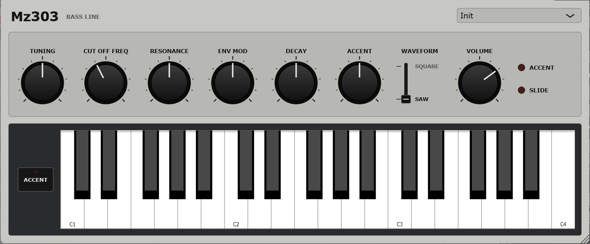

# Mz303

**A TB-303 for your DAW.** Mz303 is a VST3 instrument, and a standalone app, that emulates
the Roland TB-303 Bass Line of 1981. That's the squelching, sliding acid lines behind a few
decades of electronic music.

Mz303 models the 303's circuit block by block, for how the hardware behaves, not just
for the knobs it has:

- **The diode ladder filter.** Four RC sections in a chain that load each other, unlike a
  Moog ladder's buffered stages. That spreads the poles, which gives the 303 its gentler
  slope and its broad, vocal resonance. It saturates when pushed, and at full resonance it
  squelches without quite whistling on its own.
- **One oscillator, two waves.** The square is the saw put through a one-transistor
  waveshaper, as on the original, so each half still leans like the saw. That's the 303's
  hollow, reedy square.
- **Two envelopes, neither an ADSR.** The filter envelope only decays. The amp envelope has
  no knob at all: it fades slowly while a note is held and shuts in a few milliseconds when
  it ends.
- **Accent, and its "wow".** An accented note is louder and brighter, and its filter
  envelope is always short. At high resonance, accents swell rather than spike, and a run of
  them climbs higher each time, the way the 303's accent capacitor does.
- **Slide.** A fixed-time glide, with neither envelope restarting, so a slid note is
  one long phrase with the note before.

The panel has what the hardware's top edge has: TUNING, CUT OFF FREQ, RESONANCE, ENV MOD,
DECAY, ACCENT, WAVEFORM and VOLUME.

**Played from MIDI.** The original writes accent and slide into each step of its built-in
pattern sequencer. Mz303 0.1 is the voice without the sequencer, played from your DAW or a
keyboard:
- **Accent** is a note with velocity 100 or more.
- **Slide** is a note played before the last one is let go. Let go of the slid-to note while
  the first is still held and it slides back.

Also:
- **MIDI control.** Every control has a MIDI CC. Right-click any control to MIDI-learn your
  own.
- **Hover hints.** Hover over any control to see what it does and which CC moves it.
- **Eight factory patches,** from *Acid Squelch* to *Accent Wow*. Your own settings are saved
  with your project.
- **Pitch bend,** a tone either way. The 303 has none.

The instrument is monophonic, because the 303 is.

Mz303 is an independent project. Roland and TB-303 are Roland's trademarks.

## Installing

Download `Mz303-<version>-win64-Setup.exe` from the
[releases page](https://github.com/simozzer/Mz303/releases) and run it. It installs the VST3,
the standalone app, or both, and asks whether to install for everyone or just you:

- **Everyone** (needs administrator rights) puts the VST3 in
  `C:\Program Files\Common Files\VST3`, which every DAW scans.
- **Just me** puts it in `%LOCALAPPDATA%\Programs\Common\VST3`. Some DAWs need that folder
  added to their plugin paths once; in Ableton Live it goes under
  *Preferences → Plug-Ins → VST3 Plug-In Custom Folder*.

Then rescan plugins in your DAW. The installer isn't code-signed, so Windows may warn about an
unknown publisher: choose *More info → Run anyway*. Uninstall from *Settings → Apps*.

To build it yourself instead, see [Building](#building).

The standalone app, `Mz303.exe`, plays without a DAW. Its *Options* button chooses the audio
and MIDI devices. Latch ACCENT beside the on-screen keys to play them accented.

### macOS (beta)

Download `Mz303-<version>-macOS-beta.zip` from the
[releases page](https://github.com/simozzer/Mz303/releases) and unzip it. It holds the VST3, an Audio Unit (for Logic and GarageBand) and the standalone app,
for Apple Silicon and Intel Macs on macOS 11 or later.

They aren't signed by Apple, which takes a paid developer account, so macOS won't open them
with a double-click. Install them from Terminal instead. Type `bash ` (with the space), drag
`install.sh` from the unzipped folder into the Terminal window, and press Return:

    bash ~/Downloads/Mz303-<version>-macOS-beta/install.sh

It copies everything into your own Library folders, with no password needed, and clears the
"downloaded from the internet" flag that would stop your DAW loading the plugin. Then rescan
plugins in your DAW. `READ ME FIRST.txt` in the zip explains how to install by hand instead.

It's a beta: built and checked on GitHub's Macs, including Apple's own Audio Unit validator,
but not yet tried on a real one. If something doesn't work, please
[open an issue](https://github.com/simozzer/Mz303/issues).

### Linux (beta)

Download `Mz303-<version>-linux-x86_64-beta.tar.gz` from the
[releases page](https://github.com/simozzer/Mz303/releases) and unpack it. It holds the VST3, an LV2 and the standalone app, for 64-bit x86 PCs on Ubuntu 22.04 or later, or another distribution as new. For a **Raspberry Pi 5** on 64-bit Raspberry Pi OS (Bookworm or
later), download `Mz303-<version>-linux-arm64-beta.tar.gz` instead; it installs the same way.
Install it with one command in the unpacked folder:

    bash install.sh

It copies the plugins into `~/.vst3` and `~/.lv2`, where Linux hosts (Ardour, Bitwig,
Reaper, Carla, Qtractor, Zrythm) look for them, with no password needed. Then rescan plugins
in your DAW. `READ ME FIRST.txt` in the archive explains how to install by hand, and the
few libraries a minimal system might need.

It's a beta: built and checked on GitHub's Ubuntu machines, but not yet tried much in real
Linux hosts. If something doesn't work, please
[open an issue](https://github.com/simozzer/Mz303/issues).

## Playing it

In a DAW's piano roll, a 303 line is short notes, with accents drawn in as high velocities
and slides as notes that overlap the next one. Leave a gap between notes that should not
slide: on a 16th-note grid, a note half a step long is the 303's own gate length.

The ACCENT and SLIDE lights on the panel show what each note is being played as.

## Building

Needs Visual Studio 2022+ with *Desktop development with C++*, and JUCE checked out beside
this repository (`..\JUCE`, or pass `-DJUCE_PATH=`).

    .\build.ps1                 engine check, then the VST3 and the standalone
    .\build.ps1 -NoPlugin       engine check only
    .\build.ps1 -Wav out        and render demo patterns into out\ to listen to
    .\build.ps1 -Release        and the release downloads into dist\: Setup.exe and two zips

`-Release` needs [Inno Setup 6](https://jrsoftware.org/isdl.php). The installer's script is
`installer\Mz303.iss`, and it takes its version from `CMakeLists.txt`.

## Releasing

GitHub builds the downloads for every release and attaches them, so each one has its
installer:

1. Bump the version in `CMakeLists.txt`.
2. Write the notes in `docs/releases/v<version>.md`, ending with the credit line
   (copy it from the last release's notes), then commit both.
3. Tag and push: `git tag -a v0.2.0 -m "Mz303 0.2.0"`, then `git push origin main v0.2.0`.
4. The *release* workflow builds and checks the plugin, then makes a **draft** release with
   the notes and the three Windows downloads. A few minutes later its Mac job adds
   `Mz303-<version>-macOS-beta.zip` to the same draft. Read it over on GitHub and publish it.

The Mac build is `.github/workflows/mac.yml`. It also runs on every push to `main`, as a
check, and keeps the zip on the run for two weeks.

The workflow stops if the tag and the version in `CMakeLists.txt` disagree. If you create
the release on GitHub with a new tag instead, the downloads are added to it a few minutes
later. To rebuild an existing release's downloads, run the workflow from the *Actions* tab
with that tag.

The VST3 is installed to `%LOCALAPPDATA%\Programs\Common\VST3`, the per-user folder, which
needs no administrator rights. Some hosts need that folder adding to their plugin paths once.

## Layout

    Source/TB303/        the instrument - plain C++, no JUCE
      Vco.h              saw core; the square by waveshaper
      Vcf.h              diode ladder, zero-delay, with highpassed resonance feedback
      Envelopes.h        MEG (filter), VEG (amp), and the accent circuit
      Decimator.h        back down from the oversampled rate
      Engine.h/.cpp      keyboard, accent, slide, VCA
      Settings.h         the front panel, in panel units
    Source/              the JUCE plugin round it: parameters, presets, editor
    Tests/DspCheck.cpp   the engine's checks; gates the plugin build

## How it works

The voice runs at 4× the host rate (2× above 50 kHz) and is filtered back down, so the
filter's and VCA's saturation have room to put their harmonics.

**VCO.** One sawtooth core. SQUARE is that saw through a waveshaper that switches a little
under halfway up the ramp and lets some of the ramp through, so it is not a clean pulse.
Every edge is band-limited at its exact sub-sample position.

**VCF.** A diode ladder: four RC sections in a chain, each loaded by the next, with the top
capacitor half the size of the others. Each rung's current is tanh of the voltage across it,
the bottom differential pair's most of all. Resonance feeds the top back to the bottom pair
through a coupling capacitor, a highpass at about 90 Hz, so the lowest notes get less
feedback. The whole loop is solved with zero-delay feedback, so cutoff and resonance stay
accurate to the top of the range.
- **RESONANCE** tops out just short of self-oscillation: the loop gain at full is 17, and the
  ladder whistles from about 18 (more for low cutoffs).
- **The bass:** feedback costs a ladder its passband. Part of that is made up at the output,
  so full resonance takes about 6 dB off a bass line rather than 17. That is a departure
  from the strict circuit, so RESONANCE doesn't act as a volume knob.
- **ENV MOD** sweeps up to 4 octaves above the resting cutoff, and turning it up also lowers
  the resting cutoff by up to an octave, as the 303's knob shifts the envelope's range.

**MEG** (the filter envelope). A decay only, triggered by each new note and ignoring the gate.
DECAY sets 0.2–2.5 s to fall to 5%. An accented note always decays at the shortest.

**VEG** (the amp envelope). No knob. A few milliseconds up, an e-fold every 2 seconds while
held, a few milliseconds down when the note ends.

**Accent.** The MEG, scaled by ACCENT, goes to the cutoff (up to 2.5 octaves) and to the VCA
(up to double). On its way to the cutoff it passes the accent capacitor, and the second half
of the RESONANCE pot, ganged with the first, decides how much goes through the capacitor
rather than round it. At low resonance each accent is a sharp blip, the same every time. At
high resonance it swells, its peak arriving late, and accents close together climb.

**Slide.** An RC on the pitch CV that gets most of the way in about 120 ms, a 16th at
120 BPM. Neither envelope restarts.

**Analog behaviour.** Slow thermal pitch drift and faster sub-cent jitter on the oscillator,
and a trace of noise at the filter's input.

## MIDI

Notes play the voice, with last-note priority: velocity 100 or more is an accent, and a note
played over the one before slides. Pitch bend is a tone either way. Every panel control also
has a fixed CC. A CC moves the control itself, so the panel follows and the host can record
it. 0–127 covers the whole travel, and the switch takes the nearest position. Hover over any
control for what it does and its CC.

Where General MIDI 2 defines a matching controller, that number is used.

| Control | CC |
|---|---|
| Tuning | 14 |
| Cut Off Freq | 74 |
| Resonance | 71 |
| Env Mod | 15 |
| Decay | 75 |
| Accent | 16 |
| Waveform | 70 |
| Volume | 7 |

The table lives in `Source/Params.cpp`. Each control's CC, hover hint and saved state are
defined there together.

**MIDI learn.** Right-click any control (or its label) to open its menu:
- **MIDI Learn:** the control is outlined in red until a CC arrives, and that CC is assigned
  to it. Right-click again to cancel.
- **Forget CC:** the control stops answering to MIDI.
- **Restore default:** puts back the CC from the table above.
- **Reset all CCs to defaults.**

Each CC drives one control at a time. If you learn a CC that another control was using, that
control loses it. CCs 0 and 32 (bank select), 1 (the mod wheel) and 120 and up (channel mode)
can't be learned. Assignments are saved with the project, and the hover hint always shows a
control's current CC.

## Not yet calibrated against hardware

The structure follows the circuit: the loaded diode ladder, the waveshaped square, the
decay-only MEG, the fixed VEG, the accent capacitor and its ganged pot, the fixed slide. The
numbers inside it are reasoned, not measured from a real TB-303: the knob ranges, the
waveshaper's threshold and lean, the ladder's saturation, the feedback's coupling corner,
the envelope and slide times, and the accent capacitor's charge and drain. Each is a single
named constant, and the next step towards "as close as possible" is to measure a real unit
and fit them.

## Licence

Created by Simon Moscrop.

Mz303 is free software under the GNU Affero General Public License v3; see
[LICENSE](LICENSE). It is built with [JUCE](https://juce.com), used under the same licence.
